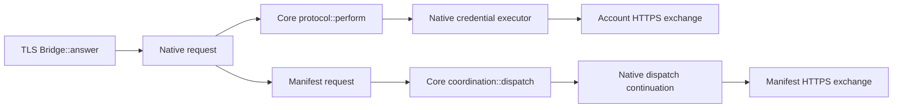

# Compiler-specialized callback linkage

The optional `dev/verification/specialized_calls.py` check follows concrete
callback targets in a compiler-specialized extraction of `garrett-bridge`.
It complements the [library call-site ledger](native-call-ledger.md), whose
polymorphic direct traversal stops before several executor callbacks.

This is **implementation-link evidence**, not a complete-mediation, dominance,
data-flow, native trace-refinement or confidentiality proof. The report always
sets `complete_mediation` to `false`.

```bash
python dev/verification/specialized_calls.py
python dev/verification/system.py --proofs --full-tests --call-linkage
```

The existing pinned Rust/Charon tools and `gzip` are required; bootstrap them
through `dev/verification/garrett.py bootstrap` if needed. Use `--charon` for
an existing matching tool in another checkout. No TPM, VM, provider credential
or AIVM installation is used. The bridge is compiled, never executed.

## What it checks

Charon specializes normal-feature bridge entry points from `main`. The tool
checks paths through actual concrete instantiations of:



These are **call-graph paths**, not feasible execution traces. In particular,
their presence does not establish that every provider write is dominated by
authorization, or that no other path can emit bytes. The independently checked
Lean controller contracts, concrete adapter tests and environmental premises
retain their separate scopes.

The [authentication-line refinement](verified-http-auth.md) adds two required
paths through the account/manifest byte builders to the extracted
`http_auth::append_header` and its validator. The helper has a separate exact
byte theorem. These additional graph witnesses still do not establish that
every native output path is mediated by that helper.

The projection retains every translated function, including functions outside
the direct request-root traversal, opaque dependencies, compiler-generated
helpers and drop-site counts. Charon's trailing `Instantiated` name component
is handled explicitly; a generated constant/closure/drop helper is not mistaken
for the named method merely because it shares its name prefix. Missing intended
callback links fail the check. Unresolved trait/function-pointer calls remain
listed, never silently treated as pure leaves.

## Bounded capture and projection

Each invocation creates a fresh private `.tools/specialized-calls-*/` directory.
Compiler output goes through a private FIFO into gzip, with defaults of:

- 8 GiB uncompressed and 512 MiB compressed output;
- a 300-second compiler deadline;
- a 120-second projection deadline.

These are output and elapsed-time limits, not a compiler RAM limit.
Failure, empty output, a deadline or a size limit cannot produce a passing
report. The tool stops its own compiler process group and removes the FIFO.
Compressed-byte limits apply to the actual writes, including gzip's footer.
Both decompressor and projector must exit successfully, so a CRC error cannot
be hidden behind valid JSON bytes.

The separate `garrett-call-ledger` Rust development crate projects the pinned
Charon schema with streaming Serde visitors. It scans irrelevant type metadata
without constructing a multi-GB object tree. It rejects compiler errors,
unreviewed call/terminator forms, missing/doubled declarations, missing source-file
records, trailing input and an absent specialized bridge main. The broker has
no dependency on this tool, and no broker implementation change is required.

The first full extraction was 4.39 GB uncompressed and 150 MB compressed.
An independent event-by-event Python pass and the Rust projector agreed on all
3,316 function records, direct targets, unresolved calls and drop counts.
The prototype Rust pass took 14 seconds and about 11 MB of memory on this host;
these are one-snapshot observations, not performance guarantees. The two
unresolved trait calls were in PEM parsing outside the direct `answer`
traversal. The request-root traversal still reached 780 opaque declarations.
Those boundaries and their possible callbacks remain obligations.

Compiler cleanup sites can greatly outnumber source statements. Site counts
are neither runtime effect counts nor security scores. A marker-trait pruning
experiment exceeded its deadline and was discarded; the successful evidence
retains the unpruned extraction.

## Provenance and remaining work

The output directory contains compiler/build/projector logs, `capture.json`,
the compressed AST, `projection.json` and `report.json`. Reports bind known native
Rust/build inputs, the analysis sources and binary, compiler-driver hashes,
the source commit/dirty state and artifact hashes. Input or analysis-source
changes during the run invalidate it. These records assume trusted compilation
and the host environment; they are not remote attestation or proof that every
transitive build input has been independently authenticated.

Remaining W3/W6 work includes dependency callbacks, concrete drop/unwind
behavior, control-flow admission dominance, credential/data flow, byte adapters
and implementation-to-trace refinement. Startup, legacy forwarding and the
native profiles have distinct observers and release rules. A compiled binding
witness does not promote them to one system-level secrecy theorem.

Rust projector unit tests and the Python stream/linkage regressions run through
the ordinary usable-system gate. Full compiler regeneration is the explicit
`--call-linkage` option; hosted CI execution of that heavier option remains
separate evidence from a local pass.
