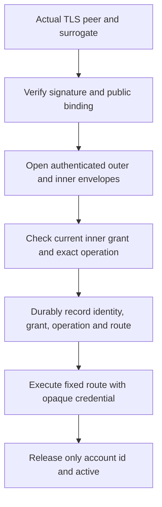

# Composed Garrett request controller

The native `account-status-v1` path now calls one extracted Rust controller
from presentation of a surrogate through credentialed provider use and public
reply projection. The implementation is
[`protocol.rs`](../rust/crates/aivm-secrets-garrett-core/src/protocol.rs);
[`GarrettProtocol.lean`](../proofs/GarrettProtocol.lean) checks its composition.
This closes an implementation-linkage gap between the earlier token-opening
and credential-use proofs. Whole-service trace correspondence remains open.

Every native `request` takes this path. Request JSON cannot supply an
authenticated peer, prepared credential or successful authorization flag.
`describe` and `renounce` use a separate control handler which cannot dispatch
a provider request. The legacy local-broker forwarding profile remains separate.

## Checked statements

The twelve new named obligations augment the earlier issuance, opening,
credential-use and symbolic secrecy results:

| Obligation | Conditional guarantee |
| --- | --- |
| `prepared_contract` | Before execution, the private prepared value links authenticated and bound outer claims to that envelope's opened inner capability, credential, current grant and allowed operation. |
| `finish_contract` | Successful execution uses the selected route and credential and releases the declared public response fields. |
| `perform_contract` | Successful composed use has the preparation evidence, exact acknowledged dispatch record and exact provider execution evidence. |
| `perform_outer_failure` | Failed outer authentication stops the controller. |
| `perform_stolen_surrogate` | A token bound to a peer the outsider cannot authenticate as is refused, regardless of later adapters. |
| `perform_inner_failure` | Failed inner opening stops the controller. |
| `perform_unauthorized_operation` | A different operation is refused even with a current grant. |
| `perform_after_prepared` | Every execution continuation, including provider errors or divergence, follows acknowledgement of the exact dispatch record. |
| `perform_observer_failure` | Rejected dispatch acknowledgement stops the controller before its execution continuation. |
| `prepare_successful` | Valid authenticated, bound and authorized inputs can reach preparation. |
| `perform_successful` | Successful preparation, observation and provider execution yield the expected public reply. |
| `perform_projection_noninterference` | Accepted uses with different credentials/private provider content return equal replies when their approved public fields agree. |

Authentication, unsealing, inner opening, durable recording and provider
execution are explicit adapter hypotheses, rather than project-specific axioms.
The axiom audit permits only `propext`, `Classical.choice` and `Quot.sound`.
The exact snapshot passed into the controller is checked; a later enrollment
revocation does not retroactively cancel an admitted request.

The noninterference theorem concerns the returned public reply under successful
adapters. It does not equate whole-service observations, errors, timing, lengths,
logs or ciphertext bytes. An intended provider must honor the reviewed
disclosure contract: a malicious provider can encode secrets into public fields.

## Concrete audit boundary

The Rust dispatch observer receives no credential. It records the exact signed
public identity claims (excluding ciphertext), inner binding and lifetime,
grant/policy identifiers, operation and configured route. The executor only
runs after this record is written, terminated with a newline and synced.
Completion is recorded before public result release. A recorded dispatch
expresses intent; it does not establish that the remote effect succeeded.

The audit adapter holds an exclusive nonblocking file lock for the session,
checks for a complete existing final line after obtaining the lock, and rejects
an incomplete tail. Any write/sync failure permanently fails that session's
audit sink. Real file-size-limit tests demonstrate denial before provider I/O
and continued denial after the host removes the file-size condition. Separate
tests cover competing sessions and partial logs on restart.

These behaviors assume the trusted host and filesystem honor locking and sync
and protect the file and its directory. They are not a tamper-evident audit log,
full historical JSON validation, rollback prevention or proof of storage
durability. An unrestricted process sharing the broker's host UID can read its
private files; mode checks do not substitute for isolation from the agent.

## Reproduce and remaining work

Run `dev/verification/garrett.py check` and `mutate` as documented in
[verified Garrett](verified-garrett.md). The gate checks 65 named obligations.
Twenty-two changes to actual Rust are re-extracted and must fail the unchanged
proofs. The composition mutations bypass authorization or audit acknowledgement,
substitute the recorded identity, or change the dispatched route.

The public predicates can express issuer provenance and dispatch association,
but implementing their adapters is not itself a proof that concrete byte-level
I/O histories satisfy them. Finite service histories linking issuance,
enrollment updates, observations and effects, concurrent-state linearization,
parser/crypto/HTTP/filesystem refinement, durable CA/OAuth authority and physical
TPM provenance remain in the
[acceptance plan](planning/aivm-secrets-garrett-verification.md). General policy
and provider support also remain open. The implementation is experimental and
unaudited; this checkpoint does not complete that campaign. The subsequent
[issuance and history layer](verified-history.md) adds recorded issuance,
ideal signature origin and conditional source-controller histories; concrete
service-history refinement remains open.

## W4 candidate scope (2026-10-17)

The new [W4 source-linked trace model](verified-w4-core-trace.md) composes extracted Rust manifest authorization, parameter checking, and recursive response projection into a **modeled** two-phase sink invariant. It does not extract the native manifest session or concrete I/O adapters; kernel compilation is still pending. The original controller composition and the global service-level refinement obligations described above remain open.
