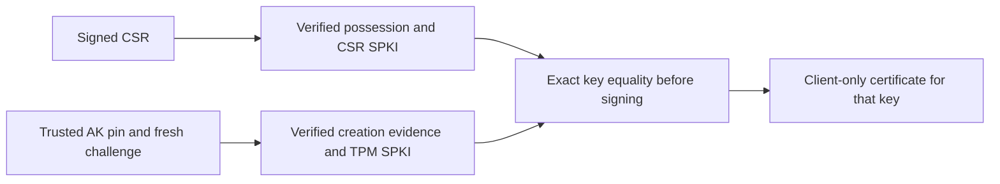

# Rust client certificate approval and TPM key binding

The optional `p256-client-enrollment-v1` library profile joins possession-checked
CSRs, explicit operator or TPM approval, and real X.509 client signing.
[`certificates.rs`](../rust/crates/aivm-secrets-garrett/src/certificates.rs)
implements the adapters; the actual
[`enrollment.rs`](../rust/crates/aivm-secrets-garrett-core/src/enrollment.rs)
controller is extracted and checked in
[`GarrettEnrollment.lean`](../proofs/GarrettEnrollment.lean).

The useful guarantee is key binding: a fresh attestation for one key cannot
authorize signing a client certificate for a different CSR key. A software key
approval cannot acquire the TPM assurance label. These are source-controller
guarantees under the stated possession, attestation and certificate-signing
adapter contracts; they do not establish physical TPM or workload provenance.

## Normal library API

`ClientRequest::from_pem` verifies CSR possession before constructing a candidate.
`CertificateAuthority::from_pem` loads an operator-selected private root and
checks its self-signature, key matching, CA/path constraints, signing usage and
extension profile. `generate` creates a fresh in-memory root. The CA has no
public formatting or private-key serialization API in normal builds.

The caller explicitly chooses one enrollment method:

- `enroll_software` requires the operator-approved SHA-256 SPKI fingerprint.
- `enroll_tpm` consumes opaque `VerifiedIdentity` evidence from the fresh
  attestation verifier and requires exact CSR/attestation SPKI equality.

TPM enrollment rechecks the original monotonic challenge deadline at admission.
Retaining a verified object does not renew its 120-second lifetime. This adapter
freshness check is tested separately from the extracted key-binding decisions.

The assurance label belongs to the returned plan, not an X.509 extension. A
hardware-only identity policy must select the TPM path and retain that policy
when installing the certificate. A TLS certificate alone does not establish
TPM custody.

There is no fallback from failed TPM evidence or key matching to software
approval. No JSON `tpm_backed` field creates evidence. The signing trait's real
adapter is private, so a library caller cannot bypass approval by submitting
an arbitrary prepared plan directly to the CA signer.

The subject is selected by the trusted host and preserved in the returned plan.
The leaf's CN is the reference's generic `aivm-guest`; it never imports the
untrusted CSR subject. Assigning that certificate to a VM/access identity
requires the host's subsequent registry transaction. Neither CSR possession
nor a trusted TPM key alone establishes which process or VM requested it.

## Supported certificate profile

CSRs use canonical uncompressed P-256 SPKI and ECDSA/SHA-256 possession
signatures, with bounded single-PEM input and no requested certificate
extensions. Empty extension requests are accepted; duplicate attributes,
bad signatures, other curves/algorithms and trailing DER/PEM data are refused.
CSR attributes do not grant authority. This is a closed profile, not general
PKCS#10 interoperability or all-input equivalence with Python.

Roots are self-signed P-256 certificates with critical CA basic constraints,
path length zero and certificate-signing usage. Only basic constraints, key
usage and key identifiers are supported; other restrictions are refused rather
than silently ignored. Root certificates must match their private key.
The [rcgen signing API](https://docs.rs/rcgen/0.14.10/rcgen/struct.CertificateParams.html#method.signed_by)
leaves issuer/CA validation to its caller; the adapter performs these checks
before allowing the signing path.

Client parameters are freshly constructed with CA=false, digital-signature
usage and client-auth EKU only. Serials use fresh OS entropy. The reference's
seven-day client lifetime and 60-second skew are retained, and the complete
leaf window must lie inside the selected CA window with strict end expiry.
Software parity checks compare CSR fingerprints and parsed certificate key,
issuer, subject, capabilities and validity; random signatures/serials preclude
byte-identical certificate comparison.

## Checked controller properties

The ten new named obligations establish exact approval decisions, correct plan
subject/SPKI/assurance/validity, the signing contract on that exact plan,
rejection before signing for substituted TPM keys or unapproved software keys,
absence of software-to-TPM label escalation, and successful enrollment.
They quantify complete SPKI byte vectors; TPM key binding does not assume that
matching a separate Boolean or hash establishes key equality.

CSR signature checking, attestation parsing/crypto, CA validation and X.509
encoding/signing remain named adapter boundaries. `rcgen`, `x509-parser`,
`time`, cryptographic libraries, entropy and tool/compiler models are trusted;
the Lean statements do not prove those implementations. No admitted proof or
project-specific security axiom is introduced.

## Tests and remaining authority work

Synthetic tests cover Python/Rust CSR and certificate behavior, CA key and
constraint failures, malformed/extended CSRs and an actual software-TPM path.
That path signs a PKCS#10 request through `tpm2_sign`, verifies fresh creation
evidence, issues a matching client certificate in Rust, and performs a brokered
provider action using that certificate and the TPM signer. A different CSR
with the same evidence, a stale challenge and an otherwise valid verified
object aged past its deadline all fail.

The gate inventories 65 named obligations and 22 Rust security mutations.
Use the [reproduction commands](verified-garrett.md). The explicit conformance
feature can serialize synthetic CA/server fixture keys; normal builds cannot.
Never use that test interface for live keys or expose it as an authority service.

This module does not install registry rows, persist newly generated roots,
perform coordinated CA/server/issuer rotation or recover partial authority
transactions. Those normal host administration paths remain to be ported.
It does not migrate existing Python state. AK provenance, EK activation,
physical hardware, signing-oracle isolation and workload identity remain the
[independent enrollment obligations](verified-garrett.md#tpm-custody-and-enrollment-evidence).
The broader [acceptance plan](planning/aivm-secrets-garrett-verification.md)
remains active; the project is experimental and unaudited.

Local validation passed with 1,912 tests and one expected pending full-primitive
runner skip (290.75 seconds), 75 selected Garrett tests, and 35 selected
certificate/TLS/provider checks using normal client/bridge builds. The 65 named
obligations pass the permitted axiom audit. Hosted CI and physical TPM
validation remain unexecuted.
